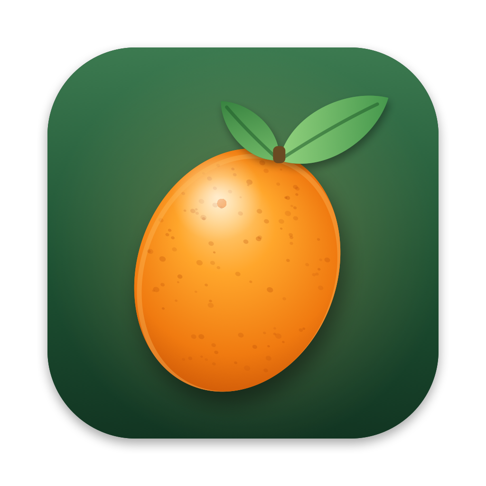

<p align="center"></p>

<h1 align="center">Kumquat</h1>

<p align="center">
  A menu-bar file converter for macOS that works entirely on your Mac.<br>
  Images, video, audio, PDFs, documents, spreadsheets, data, subtitles, archives, fonts and 3D models,
  all from one ring of options.
</p>

<p align="center">
  <a href="https://github.com/organetto8/Kumquat/releases/latest"><b>Download for macOS</b></a> ·
  <a href="docs/USER_GUIDE.md">User guide</a> ·
  <a href="#build-from-source">Build from source</a>
</p>

---

## What it does

Hold a file with the mouse, press a key, and a circular menu appears under the pointer. Drop the file on
the option you want and the new file appears in the same folder. The original is left alone.

- **Convert** (⇧ Shift) turns a file into another format: HEIC to JPG, MOV to MP4, PDF to Word, XLSX to CSV,
  a video to its subtitles, a document to an audiobook: about 1,190 combinations.
- **Edit** (⌘ Command) changes it: compress, trim, crop, merge, split, remove a photo background, read text
  with OCR, sign and redact PDFs, translate, summarise, cut silences, add subtitles: 73 tools in all.
- **Send** (⌃ Control) passes it on: AirDrop, Wi-Fi to a phone, the Basket shelf, a favourite folder,
  the Trash, Photos, a Shortcut or your own script: 27 actions.

Every key can be changed in Settings. Nothing is uploaded, there is no account, and there is no usage cap.

## Install

1. Download `Kumquat-x.y.z.dmg` from the [latest release](https://github.com/organetto8/Kumquat/releases/latest).
2. Open it and drag **Kumquat** onto **Applications**.
3. Open Kumquat from Applications. macOS blocks the first launch because the app is not notarised by Apple:
   go to **System Settings ▸ Privacy & Security**, scroll down and click **Open Anyway**.

A kumquat appears in the menu bar and a short welcome window explains the basics. The
[user guide](docs/USER_GUIDE.md) covers everything else, including the optional extras for audio and video.

Requires macOS 14 Sonoma or later, on Apple silicon or Intel.

## Quick start

1. In Finder, start dragging a photo and keep the mouse button down.
2. Tap **⇧ Shift**. The Convert wheel opens.
3. Drop the photo on **PNG**. `photo.png` appears beside `photo.heic`.

No mouse? Select files in Finder and press **⌃⌥K**, then use the arrow keys and Return.

Want to see everything Kumquat can do? Click the kumquat icon ▸ **All Actions** and browse Convert, Edit and Send
by kind of file. Choosing an entry runs it on the Finder selection, or asks for the files.

## Supported formats

| Input | Can become |
|---|---|
| JPG, PNG, WebP, HEIC, TIFF, AVIF, BMP, JPEG XL, JPEG 2000, ICO, ICNS (SVG, PSD, TGA, EXR and camera RAW read only) | any of the others, GIF, PDF, or SVG (traced) |
| MP4, MOV, MKV, WebM, AVI, WMV, GIF (MTS, TS, MPG, VOB, 3GP, FLV, OGV read only) | any of the others, animated WebP, MP3, M4A, WAV, FLAC, or subtitles of the speech (SRT, VTT, TXT) |
| MP3, M4A, WAV, FLAC, OGG, Opus, AIFF, WMA, M4B, CAF, AC3 (AMR read only) | any of the others, iPhone ringtone, MP4 with a waveform, or a transcript |
| PDF | DOCX, Pages, PPTX, XLSX, EPUB, TXT, Markdown, HTML, RTF, ODT, CSV, TIFF, JPG, PNG, HEIC or WebP pages, spoken M4A |
| DOCX, DOC, ODT, RTF, Pages, Markdown, TXT, EPUB, HTML, LaTeX, reST, AsciiDoc, Org, MOBI, AZW3 (RTFD, FB2, clipping read only) | each other, PDF, spoken M4A |
| PPTX, PPT, Keynote | PDF, JPG, PNG, PPTX, Keynote, MP4, GIF, HTML |
| XLSX, ODS, CSV, TSV (XLS and Numbers read only) | each other, PDF, JSON, Markdown or HTML table, SQLite, vCard and iCal from CSV/XLSX |
| JSON, YAML, XML, plist, TOML · SQLite · vCard · iCal | each other · CSV, XLSX, JSON · CSV, XLSX |
| SRT, VTT, ASS/SSA, SBV, TTML, LRC | each other, or TXT |
| ZIP, TAR, GZIP, XZ, BZIP2, 7Z, DMG (RAR read only) | each other |
| TTF, OTF, WOFF, WOFF2 | each other |
| OBJ, STL, PLY, USDZ, USD | each other |

Scanned PDFs and images go through on-device text recognition whenever text is needed. Speech recognition,
reading aloud, translation and summaries also run on the Mac.

## Optional extras

Most formats work out of the box. A few rely on free programs: open **Settings ▸ Engines** and click
**Install** next to the ones you want. Kumquat downloads its own build for your Mac, with no Homebrew and no
password needed. If you already use Homebrew, these commands work too and Kumquat finds what they install:

| For | With Homebrew |
|---|---|
| Audio and video | `brew install ffmpeg` |
| Saving WebP images, animated WebP | `brew install webp` |
| Saving JPEG XL | `brew install jpeg-xl` |
| Pictures to SVG | `brew install potrace` |
| LaTeX, reST, AsciiDoc, Org | `brew install pandoc` |
| Kindle e-books | `brew install --cask calibre` |
| 7-Zip | `brew install sevenzip` |
| WOFF2 fonts · TrueType ↔ OpenType | `brew install woff2` · `brew install fonttools` |
| Pages, Keynote, PowerPoint, Numbers, XLS | Pages, Keynote and Numbers from the Mac App Store |

For Pages, Keynote and Numbers, **Install** opens the App Store. Options that need something missing appear
dimmed in the wheels and in All Actions.
Translate and Summarize need macOS 26; Summarize also needs Apple Intelligence.

## Privacy

All work happens locally with Apple frameworks (ImageIO, PDFKit, Vision, Core Image, Speech, Translation,
Foundation Models, Model I/O, AppKit) and the optional tools above; your files never leave the Mac. Kumquat goes
online only to GitHub, for two things: the daily [update check](#updates), which you can turn off, and **Install**
in Settings ▸ Engines, which downloads that one program from Kumquat's own
[engines releases](https://github.com/organetto8/Kumquat/releases) and checks it against a fingerprint built into the app.
Wi-Fi Share only serves the files you chose, through a private link in its QR code, to devices on your own network while its window is open.
It asks for permissions only when a feature needs them:

- **Automation**, to read the Finder selection for the keyboard shortcut and to drive Pages, Keynote and Numbers.
- **Input Monitoring**, only if you set a wheel to a number key (1, 2 or 3) instead of a modifier.
- **Speech Recognition**, for transcriptions; **Photos**, for Add to Library; **Local Network**, for Wi-Fi Share.

## Build from source

Requires macOS 14+ and Xcode 16+ (Swift 6.2).

```bash
git clone https://github.com/organetto8/Kumquat.git
cd Kumquat
make install
```

| Command | Result |
|---|---|
| `make test` | runs the test suite (media tests run when FFmpeg is installed) |
| `make app` | builds `build/Kumquat.app` for this Mac |
| `make install` | builds, copies to /Applications and launches |
| `make release` | universal DMG, ZIP, the ZIP's update signature and `SHA256SUMS.txt` in `build/`, ready for a GitHub release |
| `make notarize` | notarised DMG (needs a Developer ID and a `notarytool` profile named `kumquat`) |
| `make icon` | redraws the icon from `Scripts/make-icon.swift` |

`make app` signs with your first *Apple Development* identity if you have one, so macOS keeps granted
permissions across rebuilds; otherwise it signs ad hoc. Set `SIGN_IDENTITY` to choose another.

### Project layout

```
Sources/KumquatCore/   conversion engines, no UI, covered by tests
  Model/               formats, operations, and what each wheel offers
  Engines/             image, media (FFmpeg), speech, PDF, documents, language, spreadsheets, data,
                       subtitles, archives, folders, fonts, 3D models
  Executor.swift       runs an operation on a selection: dispatch, concurrency, progress, file names
  Updates/             the updater: release list, signature check, download, install
Sources/Kumquat/       the menu-bar app: drag detection, wheel, jobs, actions, Basket shelf, settings
Tests/                 catalogue and end-to-end engine tests
Scripts/               app bundle, icon and release-signing scripts; engines/ builds the engine pack
```

## Releases and feedback

Stable versions are the [latest release](https://github.com/organetto8/Kumquat/releases/latest); betas appear as
pre-releases. Changes are listed in the [changelog](CHANGELOG.md).

### Updates

Once a day Kumquat asks GitHub for its list of releases. When there is a newer version it downloads it, checks
it, and offers to install it and relaunch. It installs only what passes every check:

- the download must carry an Ed25519 signature made with the release key, whose private half never leaves the
  maintainer's Mac: not GitHub, not CI. A hijacked GitHub account or a tampered connection can't produce it;
- the signature covers the app's identifier, the version and the file's SHA-256, and only a version higher than
  the installed one is accepted, so an old release can't be passed off as new;
- the unpacked app must be Kumquat at exactly that version, with an intact code signature, before it replaces
  the old one. Kumquat never asks for an administrator password: if it can't write where it is installed, it
  sends you to the download page instead.

The requests go over HTTPS to GitHub only, with no cookies, no identifiers and nothing about your files.
**Settings ▸ General ▸ Updates** turns the daily check off, includes betas, or checks right away.

- Questions and ideas: [Discussions](https://github.com/organetto8/Kumquat/discussions).
- Bugs and requests: [issues](https://github.com/organetto8/Kumquat/issues/new/choose). For a bug, paste the text
  from **⋯ ▸ Copy Diagnostic Info** in the menu bar panel.
- Security problems: report them privately, as [SECURITY.md](SECURITY.md) explains.
- Pull requests are welcome: start with [CONTRIBUTING.md](CONTRIBUTING.md).

## Licence

Kumquat is released under the [MIT licence](LICENSE).

FFmpeg (LGPL/GPL), cwebp (BSD), cjxl (BSD), potrace (GPL), pandoc (GPL), Calibre (GPL), 7-Zip (LGPL),
woff2 (MIT), fontTools (MIT) and Apple's iWork apps are separate programs that Kumquat launches when
present. They are not included in the app: Settings ▸ Engines downloads them on request from the engines
releases, which carry their source archives. If you bundle FFmpeg inside the app, include its licence and a
source offer.
